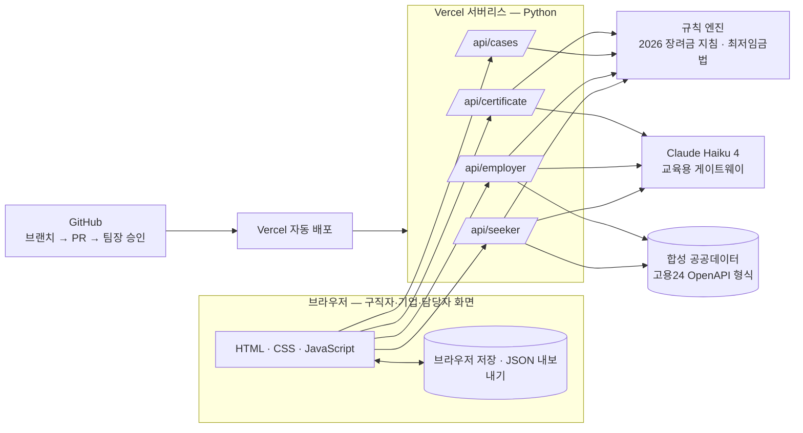

# 기능 요구 명세서 — 이음24

> 기획서(문제·타겟·AI 활용 개요): [service-plan.md](service-plan.md) · 데이터: [data-spec.md](data-spec.md) · 시연 경로·기대 결과: [test-scenarios.md](test-scenarios.md)

## 1. 개요

- 프로젝트명: 이음24 — 참여에서 채용까지
- 목적: 국민취업지원제도·청년도전지원사업 참여 청년의 이력을 채용으로 잇고, 채용 순간부터 청년일자리도약장려금 확인에 필요한 서류가 쌓이게 한다
- 대상 사용자: 참여 청년(구직자) · 중소기업 인사담당자 · 고용센터·운영기관 담당자
- 배포: https://ieum24-final-project.vercel.app (모든 데이터는 합성)

## 2. 기능 요구사항

| ID | 기능 | 설명 | 사용자 | AI | 우선순위 | 상태 |
|---|---|---|---|---|---|---|
| FR-01 | 이력 입력·저장 | 참여 사업·날짜·자유 서술 경험·희망 직무/지역 입력, 브라우저 저장·불러오기 | 구직자 | — | Must | 완료 |
| FR-02 | AI 이력 정리 | 서술형 경험 → 활동 목록·직무 역량 문장 | 구직자 | 생성형 | Must | 완료 |
| FR-03 | 맞춤 공고 추천 | 직무·기술·지역 일치 점수 + AI 추천 이유, 체불·체납·최저임금 미달·마감 공고 제외 | 구직자 | 생성형 | Must | 완료 |
| FR-04 | 지원제도 사전 안내 | 규칙 엔진 판정(채용일 기준) → 본인에게만 안내, 동의 시 기업에 표시만 | 구직자·기업 | — (규칙) | Must | 완료 |
| FR-05 | 포트폴리오 초안 | 경험 기반 초안 1회 생성, 반복·과장 문장 제외 | 구직자 | 생성형 | Must | 완료 |
| FR-06 | 초안 검토 도우미 | 원문에 없는 말·과장 표현 색 표시 → 본인 확인 체크 후 저장 | 구직자 | — | Must | 완료 |
| FR-07 | 증빙 서류 판독 | 수료증·참여확인서 이미지/PDF → 사업·날짜 판독, 입력값과 대조 | 구직자 | 멀티모달 | Should | 완료 |
| FR-08 | 기업 등록·공고 점검 | 사업자번호 형식·중복 확인, 공고별 장려금 요건 점검(28시간·450만원·최저임금·업종·지역·인원) | 기업 | 생성형(공고 정리) | Must | 완료 |
| FR-09 | 지원·채용 확정 | 지원자 목록 → 채용 확정 | 기업 | — | Must | 완료 |
| FR-10 | 표준근로계약서 | 공고·구직자 정보로 자동 작성, 최저임금 미달 저장 차단, 기업·근로자 서명 분리 | 기업·구직자 | — (규칙) | Must | 완료 |
| FR-11 | 채용 서류 판독 | 근로계약서·사업자등록증 이미지 → 규칙 점검·입력값 대조 | 기업 | 멀티모달 | Could | 완료 |
| FR-12 | 매월 급여명세서 | 서명 뒤, 지급일이 지난 달만 발급(일할 계산·정정 이력) → 근로자 서류함 | 기업·구직자 | — | Must | 완료 |
| FR-13 | 이체확인증 대조 | 이체확인증 이미지 판독 → 명세서·계약과 대조, 애매하면 '확인 필요'(원래 판독값 보존) | 기업 | 멀티모달 | Must | 완료 |
| FR-14 | 담당자 신청 건 | 채용 확정 시 자동 생성: 근거·확인 항목·6개월 경과·월별 기록·담당자 확인 항목, 처리 저장 | 담당자 | — (규칙) | Must | 완료 |
| FR-15 | 결과 내보내기·불러오기 | 저장 데이터·AI 호출 기록 JSON → 팀원 결과 합치기 | 전체 | — | Should | 완료 |
| FR-16 | 로그인·서버 저장 | 사용자별 계정·클라우드 저장(Firestore 등) | 전체 | — | Could | 다음 단계 |
| FR-17 | 알림 자동화 | 참여신청 기한·월별 서류·6개월 시점 알림 | 기업·담당자 | — | Could | 다음 단계 |
| FR-18 | 맞춤 교육과정 연결·지도 | 희망 직무·근로형태·지역으로 공공 직업훈련 과정 추천, 지도로 주변 교육 표시 (실사용자 김지은 의견) | 구직자 | 생성형(추천 이유) | Could | 다음 단계 |

## 3. 비기능 요구사항

| ID | 항목 | 요구사항 | 현재 |
|---|---|---|---|
| NFR-01 | 응답 속도 | AI 호출 1건 30초 이내, 시간 초과 시 규칙 기반 문장으로 계속 진행 | 이력 정리 10~14초 · 포트폴리오 8~10초 · 판독 4~7초 (claude-haiku-4 실측) |
| NFR-02 | 정확성 | 지원 판정은 AI가 아닌 규칙 엔진, 합성 기대 결과와 일치 | 배지 100/100 · 계약 오류 60/60 · 월별 불일치 50/50 · 정상 오탐 0/50 |
| NFR-03 | 할루시네이션 방지 | 원문에 없는 숫자·지원금·연령 차단, 목록 밖 공고 ID 차단, 원문에 없는 말은 사람 확인 | guard·문장 필터·검토 도우미 |
| NFR-04 | 개인정보 | 동의 4종(필수·AI 처리·세부정보 열람·증빙 판독), 미동의 시 AI 전송·세부정보 공개 없음, 합성 데이터만 | 화면·서버 모두 적용 |
| NFR-05 | 차별 방지 | 참여 사업명·연령은 채용 전 기업 화면에 노출 안 함, 배지 기준 정렬 없음 | 적용 |
| NFR-06 | AI 표시 | AI가 만든 내용은 "AI 초안·AI 판독값"으로 표시 | 적용 |
| NFR-07 | 보안 | API 키는 서버 환경 변수에만, 업로드 파일 형식·암호 PDF 확인 | 적용 |
| NFR-08 | 접근성·반응형 | 모바일 너비에서 가로 스크롤 없음 | 화면 테스트 |
| NFR-09 | 비용 | 서버리스(요청 시에만 실행) + 교육용 AI 키 | 운영비 0원 |
| NFR-10 | 품질 | 서버·화면 자동 테스트, main은 팀장 승인 PR로만 변경 | 106개 통과 (서버 77 · 화면 29) · CODEOWNERS |

## 4. AI 활용 명세

| 기능 | AI 활용 방식 | 상세 | 사람·규칙의 역할 |
|---|---|---|---|
| 이력 정리·추천 이유 | 생성형 AI (프롬프트) | JSON 형식 고정, 후보 공고 목록 안에서만 고르게 지시 | guard가 숫자·ID 검증 |
| 포트폴리오 초안 | 생성형 AI (프롬프트) | 같은 사실 한 번만, 평가 표현 금지, 600~900자 | 서버 문장 필터 + 검토 도우미 + 본인 확인 |
| 증빙·채용·급여 서류 판독 | 멀티모달 AI | 항목 이름별 한 줄씩 읽기(rows), 이미지 2배 해상도 | 규칙 엔진이 대조, 애매하면 '확인 필요' |
| 공고 정리 | 생성형 AI | 공고 본문 요약·기술 추출 | 요건 판정은 규칙 |
| 채용 확정 이후 흐름 | 자동화 워크플로우 | 계약서 → 매월 명세서 → 이체 대조 → 담당자 신청 건 자동 생성 | 서명·처리는 사람 |
| 이력 재사용 | 사용자별 기억(브라우저 저장) | 저장한 이력·포트폴리오를 추천·지원·계약에 다시 사용 | 다음 단계: 클라우드 저장 |

필수 기술 요소: **멀티모달 AI**, **자동화 워크플로우** (+ 생성형 AI, 사용자별 기억)

## 5. 시스템 아키텍처

## 6. 일정

| 기간 | 내용 |
|---|---|
| ~10/12 | 개인 시제품(기획·규칙 엔진·화면)에서 공개 기능을 골라 팀 프로젝트로 시작 |
| 10/13 | 팀 저장소·배포, 공공데이터 활용 명세·합성데이터 기준 |
| 10/15~10/16 | 담당자 화면·계약서·급여 흐름, 팀원별 데이터 파일·역할 분담, QA 결정 |
| 10/17 | 실제 AI 연결·판독 개선, 팀원 데이터·모델 테스트, 외부 검토 반영 |
| 10/18 | 피드백 반영(검토 도우미·파일 오류), 최종 점검, 발표 자료 |
| 10/18~10/19 | 교육생 5명 사용자 테스트(합성 사용자로 배포 서비스 체험)·피드백 반영 |
| 10/20 | 리허설 |
| 10/21 | 최종 평가 |
